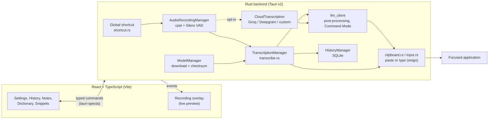

<div align="center">


**Private, offline voice typing for your desktop: press a shortcut, speak, and the text is typed into the app you're using.**

[](LICENSE)
[](https://github.com/muhib-karim/sonu)
[](https://github.com/muhib-karim/sonu/actions/workflows/ci.yml)
[](https://github.com/muhib-karim/sonu/releases/latest)

[Website](https://muhib-karim.github.io/sonu/) · [Download](#download) · [Features](#key-features) · [Architecture](#architecture) · [Testing](#testing)

</div>

---

## What it is

SONU is a cross-platform desktop dictation app built with **Tauri v2** (a Rust
backend with a React/TypeScript UI). It records from your microphone when you
press a global shortcut, transcribes the audio **on your own machine** with a
local speech-recognition model (NVIDIA Parakeet, OpenAI Whisper or Moonshine,
via [transcribe-rs](https://github.com/cjpais/transcribe-rs)), and types the
result into whichever application has focus.

Cloud transcription and LLM-based text cleanup are available, but they are
**off by default** and only send data to a provider you configure yourself.

SONU is an independent fork of [Handy](https://github.com/cjpais/Handy) by CJ Pais.

## Key features

| Feature | What it does |
| --- | --- |
| **Local transcription** | Runs speech-to-text on your device. The bundled model catalogue lists 9 models: 6 Whisper sizes, 2 Parakeet TDT 0.6B versions and Moonshine Base. |
| **Types into any focused app** | Inserts text by clipboard paste (restoring your clipboard afterwards) or simulated typing via `enigo`. |
| **Push-to-talk or toggle** | Global shortcut you can rebind; a small floating overlay shows recording and transcription state, with a live preview while you speak. |
| **Optional cloud transcription** | Groq, Deepgram, or any custom OpenAI-compatible endpoint (including one you self-host). |
| **Optional AI cleanup** | LLM post-processing with style presets and custom prompts, via OpenAI-compatible providers. |
| **Context-aware dictation** | Detects the active app and adds that context to the post-processing prompt (Windows implementation; degrades to plain post-processing elsewhere). |
| **Command Mode** | Select text, press the Command Mode shortcut, speak an instruction (e.g. _"make this more concise"_), and the rewritten text replaces the selection. Requires a configured LLM provider. |
| **Dictionary & snippets** | Custom word corrections for names and jargon; shorthand snippets that expand into longer text. |
| **History & notes** | Local SQLite history with audio playback, starring, and notes with colour, search and grid/list views. |
| **Themes & i18n** | Light, dark and system themes, accent presets, and a translated UI (i18next). |
| **Secrets in the OS keychain** | API keys are stored with the platform credential store (`keyring`), not in plain settings files. |

<div align="center">


<sub>Home dashboard, captured from the Windows build of the Tauri v2 app.</sub>

</div>

### Verification scope

- Optional AI cleanup and cloud transcription send text or audio to the remote
  provider you configure. They are not local-only processing. Model downloads
  and enabled update checks also use the network.
- CI checks frontend lint, types, build and unit tests, plus Rust formatting and
  Clippy on Linux. Rust runtime tests and the dependency audit are **advisory**,
  so a green CI badge can coexist with their failure. The Windows and macOS
  checks compile the Parakeet/Moonshine feature set (`cargo check`), not every
  engine or full desktop interaction.
- Before relying on a release, test first-run permissions, model download,
  shortcut recording, transcription and insertion into your target app on your
  OS. The model catalogue and screenshots are not proof of accuracy. No
  speed or accuracy benchmark is claimed here.

## Download

| Platform | Download | Architecture |
| :-- | :-- | :-- |
| Windows | [Installer (.exe)](https://github.com/muhib-karim/sonu/releases/latest) | x64 (ARM64 paused, [#30](https://github.com/muhib-karim/sonu/issues/30)) |
| macOS | [DMG](https://github.com/muhib-karim/sonu/releases/latest) | Intel (x64) + Apple Silicon (ARM64) |
| Linux | [AppImage / .deb / .rpm](https://github.com/muhib-karim/sonu/releases/latest) | x64 |

<details>
<summary><strong>Windows</strong></summary>

1. Download the `.exe` installer from [Releases](https://github.com/muhib-karim/sonu/releases/latest).
2. Run the installer and launch SONU from the Start Menu or system tray.
3. Download a model when prompted, then press your shortcut (default `Alt` on Windows) and speak.

</details>

<details>
<summary><strong>macOS</strong></summary>

1. Download the `.dmg` from [Releases](https://github.com/muhib-karim/sonu/releases/latest).
2. Drag SONU to Applications and grant Microphone and Accessibility permissions when prompted.
3. Press your shortcut (default `Option+Space`) and speak.

</details>

<details>
<summary><strong>Linux</strong></summary>

1. Download the `.AppImage` (portable), `.deb` or `.rpm` from [Releases](https://github.com/muhib-karim/sonu/releases/latest).
2. AppImage: `chmod +x SONU-*.AppImage && ./SONU-*.AppImage` · Debian/Ubuntu: `sudo dpkg -i sonu_*.deb`
3. Press your shortcut (default `Ctrl+Space`) and speak.

</details>

See [INSTALL.md](INSTALL.md) for more detail.

## Quick start (from source)

Prerequisites: [Bun](https://bun.sh), the [Rust toolchain](https://rustup.rs) and
the [Tauri v2 prerequisites](https://v2.tauri.app/start/prerequisites/) for your OS.

```bash
git clone https://github.com/muhib-karim/sonu.git
cd sonu/apps/tauri-v2
bun install
bun run tauri dev        # run the desktop app in development mode
```

The `whisper` engine needs libclang (LLVM) at build time. Without LLVM, build the
backend with the other two engines:

```bash
cd apps/tauri-v2/src-tauri
cargo check --all-targets --no-default-features --features parakeet,moonshine
```

## Usage

| Command (in `apps/tauri-v2`) | Purpose |
| --- | --- |
| `bun run tauri dev` | Full desktop app with hot reload |
| `bun run tauri build` | Production installers for the current OS |
| `bun run dev` / `bun run build` | Frontend only (Vite dev server / `tsc` + production bundle) |
| `bun run lint` · `bun run typecheck` · `bun run format:check` | ESLint, `tsc --noEmit`, Prettier + `cargo fmt` check |

In the app: pick a model on first run, set your shortcut under **Settings → General**,
and optionally configure **Cloud** transcription or **Post-Processing** providers.
To use your own transcription server, choose the _Custom / Self-Hosted_ provider in
**Settings → Cloud** and point it at an OpenAI-compatible endpoint.

## Architecture

The React UI talks to the Rust backend only through typed Tauri commands generated
with `tauri-specta` (`src/bindings.ts`). The backend owns audio capture, voice
activity detection, model management, transcription and text insertion.



Release builds set `panic = "abort"`, so the backend avoids `unwrap`/`expect` in
non-test code; a CI "panic ratchet" (`scripts/check-panic-ratchet.sh`) fails the
build if the number of such sites grows. See [ARCHITECTURE.md](ARCHITECTURE.md)
for more detail.

## Testing

Run from `apps/tauri-v2`:

```bash
bun install --frozen-lockfile
bun run lint                          # ESLint (type-aware rules, i18n literal check)
bun run typecheck                     # tsc --noEmit
bun run test                          # Vitest: 38 tests in 5 files
bun run build                         # tsc + Vite production bundle
bash scripts/check-panic-ratchet.sh   # unwrap()/expect() count must not grow
bun run test:rust                     # cargo test (needs the Rust toolchain + LLVM)
bun run test:e2e                      # Playwright; manual pre-release step, not in CI
```

The Rust backend has 55 `#[test]` functions (some are feature-gated).
[CI](.github/workflows/ci.yml) runs the frontend checks, `cargo fmt`, `cargo clippy -D warnings`,
the Rust tests (advisory) and `cargo audit` (advisory) on Linux, plus a `cargo check`
on Windows and macOS.

## Project structure

```
sonu/
├── apps/tauri-v2/            Desktop app
│   ├── src/                  React/TypeScript UI (components, hooks, stores, i18n)
│   ├── src-tauri/            Rust backend
│   │   ├── src/managers/     audio, model, transcription, cloud, history, offline LLM
│   │   ├── src/commands/     Tauri commands exposed to the UI
│   │   ├── src/audio_toolkit/  capture, resampling, VAD
│   │   └── resources/        model catalogue (models.json), sounds, tray icons
│   ├── e2e/                  Playwright tests
│   └── scripts/              CI helper scripts (panic ratchet)
├── site/                     GitHub Pages landing page
├── docs/                     Banner, AI features and brand docs
└── .github/workflows/        ci, build, release (5 platform builds), pages
```

## Roadmap and limitations

- Context-aware dictation is implemented for Windows only.
- AI cleanup and Command Mode use cloud LLMs today; local LLM post-processing is planned.
- Windows ARM64 builds are paused ([#30](https://github.com/muhib-karim/sonu/issues/30)).
- Language coverage depends on the model: Whisper is multilingual, Parakeet V3 covers English
  and European languages, and Moonshine Base is English.
- Planned: custom model fine-tuning, a plugin/extension system.

## Documentation

| Document | Description |
| --- | --- |
| [ARCHITECTURE.md](ARCHITECTURE.md) | Technical architecture overview |
| [INSTALL.md](INSTALL.md) | Installation guide |
| [docs/AI_FEATURES.md](docs/AI_FEATURES.md) | AI post-processing and context-aware dictation |
| [CHANGELOG.md](CHANGELOG.md) | Version history |
| [CONTRIBUTING.md](CONTRIBUTING.md) | Contribution guidelines |
| [SECURITY.md](SECURITY.md) | Security policy |
| [AGENTS.md](AGENTS.md) | Build commands and coding conventions |

## Support

If SONU is useful to you, you can [support it on Ko-fi](https://ko-fi.com/ai_dev_2024).

## License

[MIT](LICENSE). Copyright (c) 2025 CJ Pais (Handy) and 2025-2026 Muhib Karim (SONU).

## Acknowledgments

- [Handy](https://github.com/cjpais/Handy): SONU's foundation, an open-source speech-to-text app by CJ Pais
- [transcribe-rs](https://github.com/cjpais/transcribe-rs) and [whisper.cpp](https://github.com/ggerganov/whisper.cpp): local inference
- [Tauri](https://tauri.app): desktop framework
- [NVIDIA Parakeet](https://huggingface.co/nvidia/parakeet-tdt-0.6b-v2): English ASR model

<sub>SONU is an independent fork of Handy. The Handy name, logo and brand assets are not open source; SONU uses its own branding and does not imply endorsement or affiliation. SONU is not affiliated with OpenAI. Whisper is a trademark of OpenAI.</sub>
