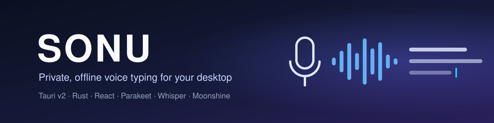
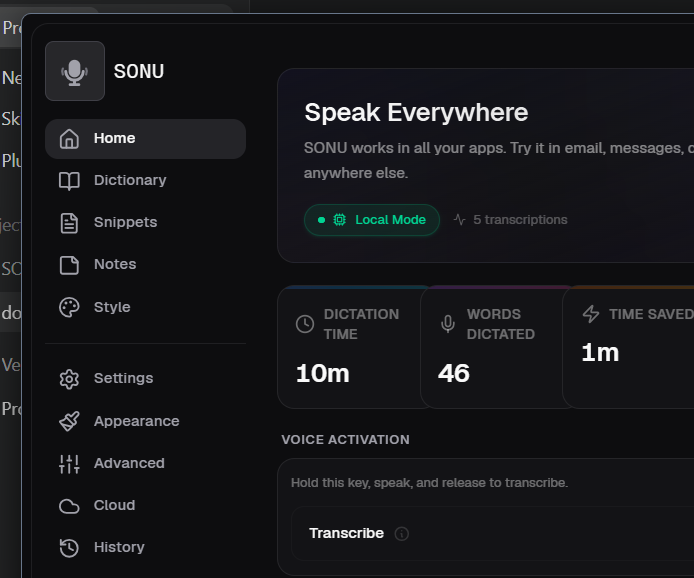
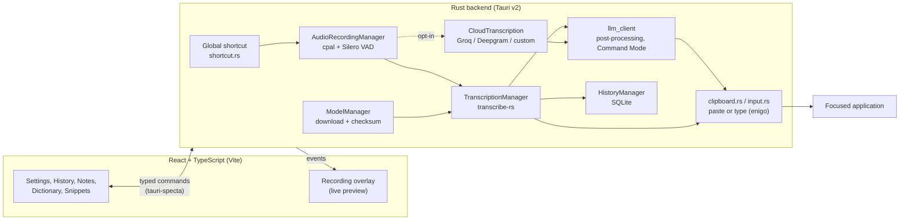

<div align="center">



**Private, offline voice typing for your desktop: press a shortcut, speak, and the text is typed into the app you're using.**

[](https://github.com/muhib-karim/sonu/actions/workflows/ci.yml)
[](https://github.com/muhib-karim/sonu/actions/workflows/ci.yml)
[](https://github.com/muhib-karim/sonu/actions/workflows/ci.yml)
[](https://github.com/muhib-karim/sonu/actions/workflows/ci.yml)
[](https://github.com/muhib-karim/sonu/actions/workflows/codeql.yml)
<br/>
[](https://github.com/muhib-karim/sonu/releases/latest)
[](https://github.com/muhib-karim/sonu/releases)
[](LICENSE)

[Website](https://muhib-karim.github.io/sonu/) · [Download](#download) · [Features](#key-features) · [Performance](#measured-performance) · [Privacy](#privacy) · [Architecture](#architecture) · [Testing](#testing)



<sub>Home dashboard, captured from the Windows build of the Tauri v2 app.</sub>

</div>

---

## What it is

SONU is a cross-platform desktop dictation app built with **Tauri v2** (a Rust
backend with a React/TypeScript UI). It records from your microphone when you
press a global shortcut, transcribes the audio **on your own machine** with a
local speech-recognition model (NVIDIA Parakeet, OpenAI Whisper or Moonshine,
via [transcribe-rs](https://github.com/cjpais/transcribe-rs)), and types the
result into whichever application has focus.

Cloud transcription and LLM-based text cleanup are available, but they are
**off by default** and only send data to a provider you configure yourself.

SONU is an independent fork of [Handy](https://github.com/cjpais/Handy) by CJ Pais.

## Upstream and what this fork adds

**Upstream.** SONU started from [cjpais/Handy](https://github.com/cjpais/Handy),
an MIT-licensed offline speech-to-text app, and was last synced with Handy
**v0.7.0** (January 2026). It has diverged since and is not automatically
re-synced. Handy supplies the foundation: the Tauri v2 app shell, global
shortcuts, microphone capture with Silero VAD, local transcription through
[transcribe-rs](https://github.com/cjpais/transcribe-rs), history, LLM
post-processing and text insertion into the focused app.

**Licence.** SONU stays MIT. [LICENSE](LICENSE) keeps the upstream copyright
notice (CJ Pais, 2025) alongside SONU's own, as MIT requires. The Handy name
and logo are not open source, so SONU uses its own branding.

**What SONU adds**, with the code that implements each item:

| Added in SONU | Since | Where |
| --- | --- | --- |
| Cloud transcription (Groq, Deepgram, any OpenAI-compatible endpoint), off by default | 2.2.0 | [`managers/cloud_transcription.rs`](apps/tauri-v2/src-tauri/src/managers/cloud_transcription.rs) |
| API keys kept in the OS credential store instead of the settings file | 2.2.0 | [`utils/keychain.rs`](apps/tauri-v2/src-tauri/src/utils/keychain.rs) |
| Notes, snippets and a dictionary UI for custom words | 2.1.0 | [`settings/notes`](apps/tauri-v2/src/components/settings/notes), [`settings/snippets`](apps/tauri-v2/src/components/settings/snippets), [`settings/dictionary`](apps/tauri-v2/src/components/settings/dictionary) |
| Context-aware dictation: the focused app picks a per-category style for the cleanup prompt | 2.3.0 | [`active_window.rs`](apps/tauri-v2/src-tauri/src/active_window.rs), [`settings/style`](apps/tauri-v2/src/components/settings/style) |
| Command Mode: speak an instruction to rewrite the selected text | 2.3.0 | [`actions.rs`](apps/tauri-v2/src-tauri/src/actions.rs) |
| Live local transcription preview in the overlay; light/dark/system themes and accents | 2.4.0 | [`overlay/`](apps/tauri-v2/src/overlay), [`settings/appearance`](apps/tauri-v2/src/components/settings/appearance) |
| Spoken commands ("new line", "new paragraph") and user-defined voice macros | 2.6.0 | [`apply_voice_commands`](apps/tauri-v2/src-tauri/src/actions.rs) |
| Model download integrity checks (sha256, or the object-store ETag) and resumable partials | 2.6.1 | [`managers/model.rs`](apps/tauri-v2/src-tauri/src/managers/model.rs) |
| Crash hardening under `panic = "abort"`, with a CI ratchet against new `unwrap()`/`expect()` sites | 2.6.1 | [`check-panic-ratchet.sh`](apps/tauri-v2/scripts/check-panic-ratchet.sh) |
| Full `tauri build` on every PR for every release target (Windows x64, macOS arm64 and x64, Linux x64); blocking Rust tests including a Whisper transcription regression; CodeQL; gitleaks | 2.7.0 | [`ci.yml`](.github/workflows/ci.yml), [`codeql.yml`](.github/workflows/codeql.yml) |
| Portable whisper.cpp build (no `-march=native`, so installers no longer depend on the build machine's CPU) | 2.7.0 | [`ggml-portable.cmake`](apps/tauri-v2/src-tauri/cmake/ggml-portable.cmake) |
| Tagged releases with `SHA256SUMS` and Sigstore build-provenance attestations | 2.7.0 | [`release.yml`](.github/workflows/release.yml) |

## Key features

| Feature | What it does |
| --- | --- |
| **Local transcription** | Runs speech-to-text on your device. The bundled model catalogue lists 9 models: 6 Whisper sizes, 2 Parakeet TDT 0.6B versions and Moonshine Base. |
| **Types into any focused app** | Inserts text by clipboard paste (restoring your clipboard afterwards) or simulated typing via `enigo`. |
| **Push-to-talk or toggle** | Global shortcut you can rebind; a small floating overlay shows recording and transcription state, with a live preview while you speak. |
| **Optional cloud transcription** | Groq, Deepgram, or any custom OpenAI-compatible endpoint (including one you self-host). |
| **Optional AI cleanup** | LLM post-processing with style presets and custom prompts, via OpenAI-compatible providers. |
| **Context-aware dictation** | Detects the active app and adds that context to the post-processing prompt (Windows implementation; degrades to plain post-processing elsewhere). |
| **Command Mode** | Select text, press the Command Mode shortcut, speak an instruction (e.g. _"make this more concise"_), and the rewritten text replaces the selection. Requires a configured LLM provider. |
| **Dictionary & snippets** | Custom word corrections for names and jargon; shorthand snippets that expand into longer text. |
| **History & notes** | Local SQLite history with audio playback, starring, and notes with colour, search and grid/list views. |
| **Themes & i18n** | Light, dark and system themes, accent presets, and a translated UI (i18next). |
| **Secrets in the OS keychain** | API keys are stored with the platform credential store (`keyring`), not in plain settings files. |

### Verification scope

- Optional AI cleanup and cloud transcription send text or audio to the remote
  provider you configure. They are not local-only processing. Model downloads
  and enabled update checks also use the network.
- CI checks frontend lint, types, build and unit tests; Rust formatting, Clippy
  (`-D warnings`) and the Rust unit tests, all blocking; a Whisper-tiny
  transcription regression on a public-domain recording; and a full
  `tauri build` for Windows x64, macOS arm64 and x64, and Linux x64. The dependency audit
  is advisory. None of this exercises real microphones, OS permissions or
  insertion into other apps.
- Before relying on a release, test first-run permissions, model download,
  shortcut recording, transcription and insertion into your target app on your
  OS. The model catalogue and screenshots are not proof of accuracy. Speed
  figures come only from the CI runner described under
  [Measured performance](#measured-performance); no accuracy benchmark is
  claimed.

## Measured performance

Measured in CI by [`benchmark.yml`](.github/workflows/benchmark.yml)
([run 39687868674](https://github.com/muhib-karim/sonu/actions/runs/39687868674), commit `01ea3b9`, **2026-10-21**) on a
GitHub-hosted **`ubuntu-24.04`** runner: 4 vCPU (AMD EPYC 7763), 15 GB RAM,
**no GPU**. Each model transcribes the same 11.0 s public-domain clip (JFK's
1961 inaugural address) through the app's own engine code
([`managers/benchmark.rs`](apps/tauri-v2/src-tauri/src/managers/benchmark.rs)),
built with the shipped `release` profile. **RTF** = median processing time ÷
audio length; below 1 is faster than real time. "First run" includes one-off
setup (Vulkan pipeline compilation, ONNX Runtime graph optimisation) paid once
per model load.

| Model | Engine | Download | Load | First run | Median run (n) | RTF | Transcript |
| --- | --- | ---: | ---: | ---: | ---: | ---: | --- |
| Moonshine Base | Moonshine (ONNX Runtime) | 58 MB | 0.85 s | 1.77 s | 1.79 s (3) | **0.16** | matches |
| Whisper Tiny | Whisper (whisper.cpp) | 75 MB | 4.22 s | 23.14 s | 14.48 s (3) | **1.32** | matches |
| Whisper Base | Whisper (whisper.cpp) | 142 MB | 0.12 s | 27.68 s | 27.51 s (3) | **2.50** | “asked not” (one word off) |
| Whisper Small | Whisper (whisper.cpp) | 487 MB | 0.46 s | 81.02 s | 81.83 s (2) | **7.44** | matches |
| Parakeet V2 | Parakeet (ONNX Runtime) | 473 MB | 1.11 s | 2.67 s | 2.26 s (3) | **0.21** | matches |
| Parakeet V3 | Parakeet (ONNX Runtime) | 478 MB | 1.16 s | 2.08 s | 2.22 s (3) | **0.20** | matches |
| Whisper Medium | Whisper (whisper.cpp) | 492 MB | not measured | | | | Whisper Small already takes 82 s per 11 s clip here |
| Whisper Large | Whisper (whisper.cpp) | 1100 MB | not measured | | | | larger than Small; same reason |
| Whisper Turbo | Whisper (whisper.cpp) | 1600 MB | not measured | | | | larger than Small; same reason |

How to read it:

- **Parakeet and Moonshine run on the CPU through ONNX Runtime** and run at least
  5× faster than real time on this 4-vCPU runner. Parakeet V3 is the app's default.
- **Whisper is slow here for a specific reason**: on Linux it is built with the
  Vulkan backend, and with no GPU the only Vulkan device is Mesa's `llvmpipe`, a
  software renderer emulating a GPU on the CPU (the log shows
  `Vulkan0: llvmpipe (LLVM 20.1.2)`). These rows are what a GPU-less Linux
  machine gets, not what whisper.cpp's native CPU backend or a real GPU would do.
  Whisper Tiny's load time includes the one-off Vulkan initialisation.
- **Not measured** (INFERRED, no numbers given): GPU performance on any platform,
  Windows and macOS (macOS uses Metal), and the three largest Whisper models.
- **Run-to-run spread**: across this run and an earlier one the same day
  ([39685635867](https://github.com/muhib-karim/sonu/actions/runs/39685635867), runner image 20261012) RTF ranged: Moonshine Base 0.10–0.16, Whisper Tiny 1.29–1.32, Whisper Base 2.45–2.50, Whisper Small 7.43–7.44, Parakeet V2 0.19–0.21, Parakeet V3 0.20–0.20.
  Treat differences under about 0.07 between CPU rows as noise.
- The "Transcript" column checks for the phrase "ask not what your country can do
  for you"; it is a sanity check on one clip, not an accuracy benchmark.

## Privacy

- **Audio stays on your machine by default.** Recording, voice activity
  detection and transcription run locally; history (text and, if kept,
  recordings) is a SQLite database and WAV files in the app's data folder, with
  a retention setting.
- **No telemetry.** The code contains no analytics, crash reporting or usage
  tracking.
- **What does use the network:**
  - model downloads, from `huggingface.co` (Whisper tiny/base) and
    `blob.handy.computer` (the upstream Handy model mirror), each checked
    against the checksum in [`models.json`](apps/tauri-v2/src-tauri/resources/models.json)
    before use;
  - the update check against this repository's GitHub releases (on by default,
    can be turned off in settings; updates are signature-verified);
  - cloud transcription and AI cleanup, **only** if you enable them and add a
    key; audio or text then goes to the provider you chose.
- **API keys** live in the OS credential store (Keychain, Credential Manager,
  kernel keyutils), never in the settings file.
- The webview's content security policy only allows connections to those
  hosts ([`tauri.conf.json`](apps/tauri-v2/src-tauri/tauri.conf.json)).

## Download

| Platform | Download | Architecture |
| :-- | :-- | :-- |
| Windows | [Installer (.exe)](https://github.com/muhib-karim/sonu/releases/latest) | x64 (ARM64 paused, [#30](https://github.com/muhib-karim/sonu/issues/30)) |
| macOS | [DMG](https://github.com/muhib-karim/sonu/releases/latest) | Intel (x64) + Apple Silicon (ARM64) |
| Linux | [AppImage / .deb / .rpm](https://github.com/muhib-karim/sonu/releases/latest) | x64 |

<details>
<summary><strong>Windows</strong></summary>

1. Download the `.exe` installer from [Releases](https://github.com/muhib-karim/sonu/releases/latest).
2. Run the installer and launch SONU from the Start Menu or system tray.
3. Download a model when prompted, then press your shortcut (default `Alt` on Windows) and speak.

</details>

<details>
<summary><strong>macOS</strong></summary>

1. Download the `.dmg` from [Releases](https://github.com/muhib-karim/sonu/releases/latest).
2. Drag SONU to Applications and grant Microphone and Accessibility permissions when prompted.
3. Press your shortcut (default `Option+Space`) and speak.

</details>

<details>
<summary><strong>Linux</strong></summary>

1. Download the `.AppImage` (portable), `.deb` or `.rpm` from [Releases](https://github.com/muhib-karim/sonu/releases/latest).
2. AppImage: `chmod +x SONU-*.AppImage && ./SONU-*.AppImage` · Debian/Ubuntu: `sudo dpkg -i sonu_*.deb`
3. Press your shortcut (default `Ctrl+Space`) and speak.

</details>

### Verify a download

Every release lists each asset in `SHA256SUMS` and carries a
[build-provenance attestation](https://docs.github.com/en/actions/security-for-github-actions/using-artifact-attestations)
proving it was built by this repository's release workflow:

```bash
sha256sum --check --ignore-missing SHA256SUMS        # macOS: shasum -a 256 -c
gh attestation verify SONU_2.7.0_amd64.deb --repo muhib-karim/sonu
```

macOS builds are ad-hoc signed and Windows installers are not code-signed yet,
so the OS will warn on first launch.

See [INSTALL.md](INSTALL.md) for more detail.

## Quick start (from source)

Prerequisites: [Bun](https://bun.sh), the [Rust toolchain](https://rustup.rs) and
the [Tauri v2 prerequisites](https://v2.tauri.app/start/prerequisites/) for your OS.

```bash
git clone https://github.com/muhib-karim/sonu.git
cd sonu/apps/tauri-v2
bun install
bun run tauri dev        # run the desktop app in development mode
```

The `whisper` engine needs libclang (LLVM) at build time. Without LLVM, build the
backend with the other two engines:

```bash
cd apps/tauri-v2/src-tauri
cargo check --all-targets --no-default-features --features parakeet,moonshine
```

## Usage

| Command (in `apps/tauri-v2`) | Purpose |
| --- | --- |
| `bun run tauri dev` | Full desktop app with hot reload |
| `bun run tauri build` | Production installers for the current OS |
| `bun run dev` / `bun run build` | Frontend only (Vite dev server / `tsc` + production bundle) |
| `bun run lint` · `bun run typecheck` · `bun run format:check` | ESLint, `tsc --noEmit`, Prettier + `cargo fmt` check |

In the app: pick a model on first run, set your shortcut under **Settings → General**,
and optionally configure **Cloud** transcription or **Post-Processing** providers.
To use your own transcription server, choose the _Custom / Self-Hosted_ provider in
**Settings → Cloud** and point it at an OpenAI-compatible endpoint.

## Architecture

The React UI talks to the Rust backend only through typed Tauri commands generated
with `tauri-specta` (`src/bindings.ts`). The backend owns audio capture, voice
activity detection, model management, transcription and text insertion.



Release builds set `panic = "abort"`, so the backend avoids `unwrap`/`expect` in
non-test code; a CI "panic ratchet" (`scripts/check-panic-ratchet.sh`) fails the
build if the number of such sites grows. See [ARCHITECTURE.md](ARCHITECTURE.md)
for more detail.

## Testing

Run from `apps/tauri-v2`:

```bash
bun install --frozen-lockfile
bun run lint                          # ESLint (type-aware rules, i18n literal check)
bun run typecheck                     # tsc --noEmit
bun run test                          # Vitest: 54 tests in 6 files
bun run build                         # tsc + Vite production bundle
bash scripts/check-panic-ratchet.sh   # unwrap()/expect() count must not grow
bun run test:rust                     # cargo test (needs the Rust toolchain + LLVM)
bun run test:e2e                      # Playwright; manual pre-release step, not in CI
```

The Rust backend has 85 `#[test]` functions (some feature-gated, two ignored by
default because they need downloaded models). On every pull request
[CI](.github/workflows/ci.yml) runs the frontend checks, `cargo fmt`,
`cargo clippy -D warnings`, the Rust tests (blocking, at least 75 must run), the
Whisper-tiny transcription regression, gitleaks, `cargo audit` (advisory) and a
full `tauri build` for every release target (Windows x64, macOS arm64 and x64,
Linux x64);
[CodeQL](.github/workflows/codeql.yml) scans the TypeScript.
[`benchmark.yml`](.github/workflows/benchmark.yml) produces the performance
table above.

## Project structure

```
sonu/
├── apps/tauri-v2/            Desktop app
│   ├── src/                  React/TypeScript UI (components, hooks, stores, i18n)
│   ├── src-tauri/            Rust backend
│   │   ├── src/managers/     audio, model, transcription, cloud, history, offline LLM
│   │   ├── src/commands/     Tauri commands exposed to the UI
│   │   ├── src/audio_toolkit/  capture, resampling, VAD
│   │   └── resources/        model catalogue (models.json), sounds, tray icons
│   ├── e2e/                  Playwright tests
│   └── scripts/              CI helper scripts (panic ratchet)
├── site/                     GitHub Pages landing page
├── docs/                     Banner, AI features and brand docs
└── .github/workflows/        ci, build (reusable), release, codeql, benchmark, pages
```

## Roadmap and limitations

- Context-aware dictation is implemented for Windows only.
- AI cleanup and Command Mode use cloud LLMs today; local LLM post-processing is planned.
- Windows ARM64 builds are paused ([#30](https://github.com/muhib-karim/sonu/issues/30)).
- On Linux without a GPU driver, Whisper runs on Mesa's software Vulkan device and is
  slow; Parakeet and Moonshine run on the CPU and are unaffected (see
  [Measured performance](#measured-performance)).
- Language coverage depends on the model: Whisper is multilingual, Parakeet V3 covers English
  and European languages, and Moonshine Base is English.
- Planned: custom model fine-tuning, a plugin/extension system.

## Documentation

| Document | Description |
| --- | --- |
| [ARCHITECTURE.md](ARCHITECTURE.md) | Technical architecture overview |
| [INSTALL.md](INSTALL.md) | Installation guide |
| [docs/AI_FEATURES.md](docs/AI_FEATURES.md) | AI post-processing and context-aware dictation |
| [CHANGELOG.md](CHANGELOG.md) | Version history |
| [CONTRIBUTING.md](CONTRIBUTING.md) | Contribution guidelines |
| [SECURITY.md](SECURITY.md) | Security policy |
| [AGENTS.md](AGENTS.md) | Build commands and coding conventions |

## Support

If SONU is useful to you, you can [support it on Ko-fi](https://ko-fi.com/ai_dev_2024).

## License

[MIT](LICENSE). Copyright (c) 2025 CJ Pais (Handy) and 2025-2026 Muhib Karim (SONU).

## Acknowledgments

- [Handy](https://github.com/cjpais/Handy): SONU's foundation, an open-source speech-to-text app by CJ Pais
- [transcribe-rs](https://github.com/cjpais/transcribe-rs) and [whisper.cpp](https://github.com/ggerganov/whisper.cpp): local inference
- [Tauri](https://tauri.app): desktop framework
- [NVIDIA Parakeet](https://huggingface.co/nvidia/parakeet-tdt-0.6b-v2): English ASR model

<sub>SONU is an independent fork of Handy. The Handy name, logo and brand assets are not open source; SONU uses its own branding and does not imply endorsement or affiliation. SONU is not affiliated with OpenAI. Whisper is a trademark of OpenAI.</sub>
